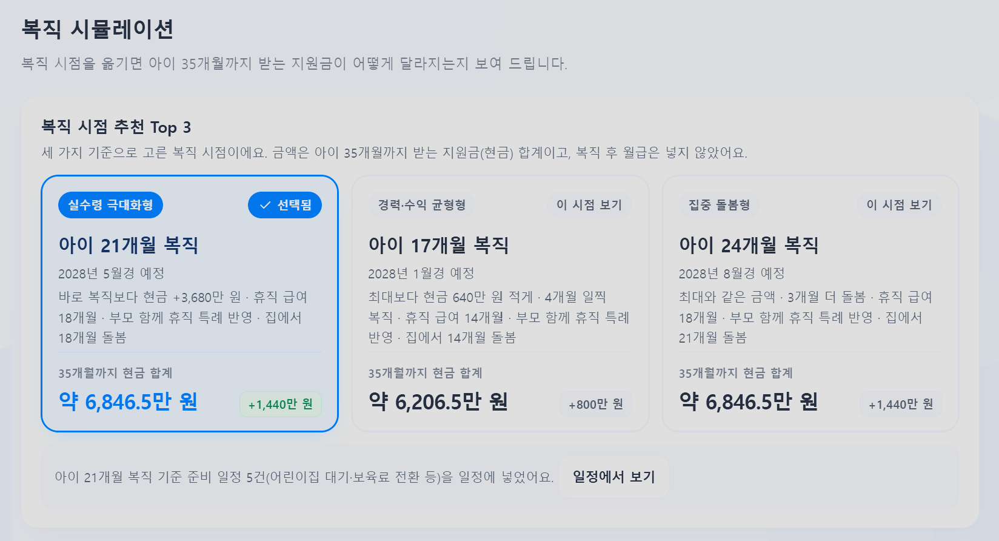
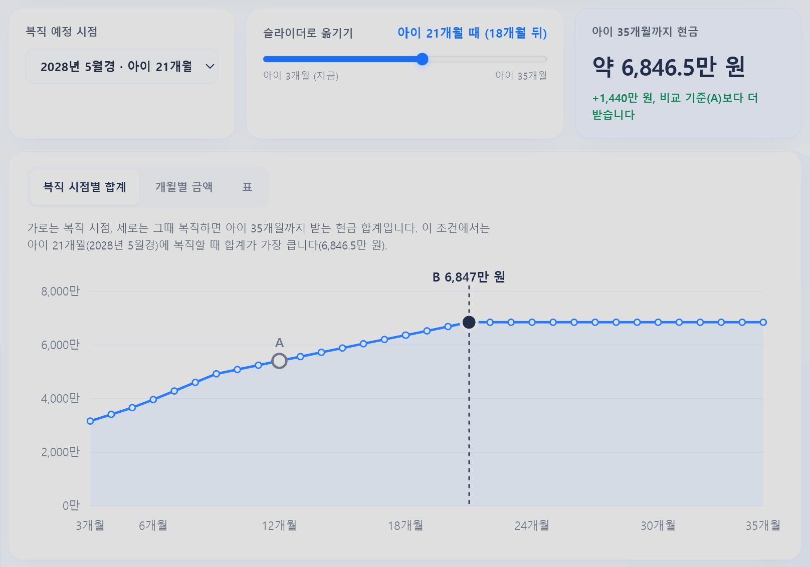
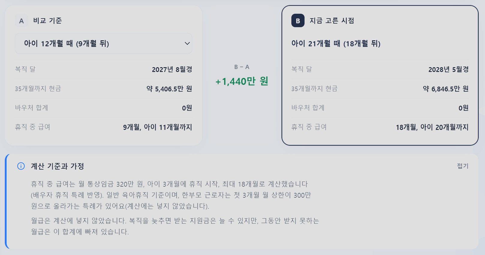
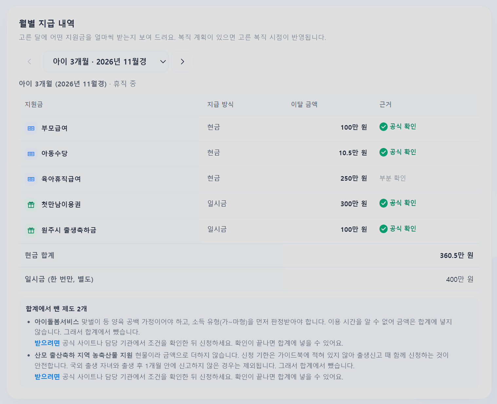
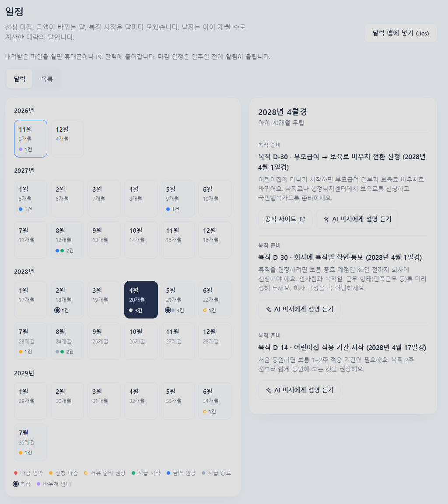
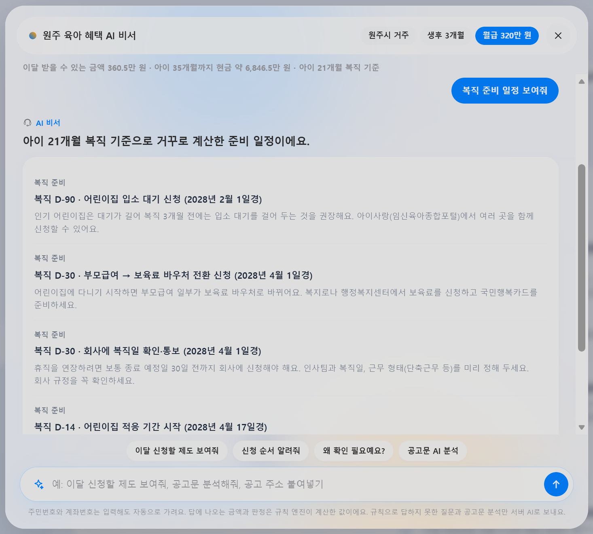

# 원주 육아 혜택 비서

> 받을 수 있는 혜택부터 복직 시점까지, 한 화면에서
> 2026 AI 해커톤 09팀 LGTM · 프로젝트명: 원주 혜택 ON Cloud

원주에 사는 영유아 맞벌이 가정이 몇 가지 질문에 답하면, 우리 집이 받을 수 있는 육아 혜택과 이번 달 예상 금액, **복직 시점에 따라 달라지는 지원금**, 복직 전에 챙길 일정과 신청 순서를 근거와 함께 보여 주는 AI 육아 혜택 비서입니다.

## 왜 만들었나

육아 혜택은 중앙정부(부모급여, 아동수당, 육아휴직급여 등), 강원특별자치도(육아기본수당), 원주시(출생축하금 등)로 흩어져 있고, 제도마다 신청처·대상 개월 수·마감·중복 규칙이 다릅니다. 특히 맞벌이 부모는 **언제 복직해야 받는 돈이 줄지 않는지**, **복직 전에 무엇을 언제 신청해야 하는지**를 직접 계산해야 했습니다.

## 주요 기능

| 기능 | 설명 |
|---|---|
| 맞춤 진단 | 거주지, 아이 개월 수, 복직 계획, 월 통상임금 등 최대 11개 질문. 이름·주민번호·주소는 묻지 않음 |
| 한눈에 보기 | 이번 달 받을 수 있는 금액, 아이 35개월까지 현금 합계, 제도별 지급 내역, 합계에서 뺀 제도와 "받으려면" 안내 |
| 복직 시뮬레이션 | 복직 시점별 35개월 합계 곡선, 월별 지급 내역, A/B 비교 |
| 복직 시점 Top 3 | 실수령 극대화형 · 경력·수익 균형형 · 집중 돌봄형 세 가지 기준으로 추천하고 근거(금액 차이, 휴직 급여 개월 수, 집에서 돌보는 기간)를 함께 표시 |
| 복직 D-Day 역산 | 복직일에서 거꾸로 D-90 어린이집 입소 대기, D-30 보육료 바우처 전환·회사 통보, D-14 적응 기간, 당일 육아휴직급여 신청 기한 확인을 일정에 자동 추가 |
| 일정 | 신청 마감, 금액 변경, 복직 준비를 달력으로 보여 주고 `.ics` 파일로 휴대폰 달력에 추가 |
| AI 비서 | 신청할 제도, 신청 순서, 판정 이유, 복직 준비 일정 등을 질문으로 확인. 규칙으로 이해하지 못한 질문은 서버 AI가 답변 |
| 공고문 AI 분석 | 공고문 PDF나 주소를 넣으면 한 줄 요약, 대상·혜택·신청 방법, 체크리스트, 쉬운 용어 풀이, 읽어 주기(TTS) |
| 개인정보 보호 | 주민번호·전화번호·계좌번호 자동 가림, 공고문 PDF 개인정보 가리기 |

## 이 서비스가 새로 더한 것

| | 일반적인 혜택 조회 | 원주 육아 혜택 비서 |
|---|---|---|
| 알려 주는 것 | 받을 수 있는 제도 목록 | 제도 목록 + **이번 달 금액과 아이 35개월까지 합계** |
| 복직 고민 | 부모가 직접 계산 | **복직 시점별 합계 비교, 세 가지 기준의 Top 3 추천** |
| 신청 일정 | 제도마다 따로 확인 | **복직일에서 거꾸로 계산한 준비 일정**과 신청 마감을 한 달력에 |
| 지역 제도 | 중앙정부 위주 | 중앙정부 + 강원도 + 원주시 제도와 중복 규칙을 함께 계산 |
| AI 답변 | 금액을 AI가 생성할 수 있음 | 금액은 규칙 엔진이 계산, AI는 설명만 |

## 화면

**복직 시점 Top 3**: 세 가지 기준으로 추천하고, 카드를 누르면 그 시점으로 바로 바뀝니다.



| 복직 시점별 합계 곡선 | A/B 비교와 계산 기준 |
|---|---|
|  |  |

| 월별 지급 내역 | 일정 (복직 D-Day 역산) |
|---|---|
|  |  |

**AI 비서**: "복직 준비 일정 보여줘"처럼 물으면 계산된 일정을 보여 주고 AI가 설명합니다.



## AI 적용 방식: 계산은 규칙 엔진이, 설명은 AI가

- **Amazon Bedrock · Claude Haiku 4.5**를 사용합니다 (`BEDROCK_MODEL_ID`로 변경 가능).
- 금액과 수급 판정은 공식 자료로 만든 **규칙 엔진**(브라우저의 `rules.js`, `plan.js`)이 계산합니다.
- AI는 계산된 결과를 쉬운 말로 설명하고, 공고문을 요약하며, 규칙으로 이해하지 못한 질문에 답합니다. 새 금액·날짜·제도를 만들지 않도록 지시합니다.
- AI 서버가 응답하지 않아도 판정·금액·일정은 브라우저에서 그대로 동작합니다.

## 기술 구조

```
브라우저 (backend/static/plan.html)
  ├─ rules.js · plan.js        규칙 엔진 (판정, 월별 금액, 복직 시점별 합계, 일정)
  ├─ catalog-verified.js       공식 자료로 확인한 제도 목록과 근거 주소
  ├─ chat.js                   질문 이해, 개인정보 가림
  └─ plan-ui.js                화면 (진단, 결과, Top 3, 일정, AI 비서)
        │  fetch
        ▼
FastAPI 서버 (backend/app/main.py, AWS EC2)
  ├─ /api/chat                 자유 질문 답변
  ├─ /api/analyze              공고문 PDF 분석
  ├─ /api/analyze-url          공고 주소 분석
  ├─ /api/explain-schedule     복직 준비 일정 설명
  └─ /api/mask                 PDF 개인정보 가리기
        │  boto3
        ▼
Amazon Bedrock (Claude Haiku 4.5)
```

PDF 처리: PyMuPDF · pdfplumber로 텍스트와 표를 추출한 뒤 AI에 전달합니다.

## 폴더 구조

```
backend/
  app/
    main.py            FastAPI 서버, API 주소
    ai_pipeline.py     Bedrock 호출, PDF 추출, 공고문 분석, 개인정보 가림
    collab_parser.py   공고 주소·HWPX 등 문서 읽기
    mock_data.py       서버 AI용 제도 목록
  static/
    plan.html          최종 화면 (첫 주소 / 로 접속하면 이 화면)
    index.html         이전 버전 화면 (/index.html)
    css/  js/  img/
  requirements.txt
tools/patches/         화면 수정 패치 스크립트 (fix_all.py, kick_all.py)
archive/               이전 스타일 백업
```

## 실행 방법

**시연 주소 (HTTPS):** https://creek-assurance-nurse-socket.trycloudflare.com/plan.html

> Cloudflare 임시 터널(trycloudflare.com)로 연결한 주소라, 터널을 다시 켜면 주소가 바뀔 수 있습니다. 접속이 안 되면 팀에 문의해 주세요.

### 1. 처음 한 번: 설치

```bash
cd backend
python3 -m venv .venv && source .venv/bin/activate
pip install -r requirements.txt
```

AI 기능을 쓰려면 Bedrock 권한이 있는 AWS 자격 증명이 필요합니다 (EC2 IAM 역할 또는 `aws configure`). 리전은 `AWS_REGION`(기본 `us-east-1`)으로 바꿀 수 있습니다.

### 2. 서버 실행 (EC2, 터미널을 닫아도 계속 실행)

```bash
cd backend
source .venv/bin/activate 2>/dev/null || source venv/bin/activate
pkill -f "uvicorn app.main:app"
nohup uvicorn app.main:app --host 0.0.0.0 --port 8000 > server.log 2>&1 &
sleep 2 && tail -n 10 server.log
```

- `pkill`: 이미 실행 중인 서버를 끄고 새로 켭니다.
- `nohup … &`: 터미널 창을 닫거나 접속이 끊겨도 서버가 계속 실행됩니다.
- 로그 계속 보기: `tail -f server.log` (끝낼 때 `Ctrl+C`, 서버는 꺼지지 않음)
- 서버 끄기: `pkill -f "uvicorn app.main:app"`

### 3. HTTPS 주소 연결 (Cloudflare 임시 터널)

```bash
nohup cloudflared tunnel --url http://localhost:8000 > tunnel.log 2>&1 &
sleep 5 && grep -o "https://[a-z0-9-]*\.trycloudflare\.com" tunnel.log | head -1
```

마지막 줄에 나온 `https://….trycloudflare.com` 주소 뒤에 `/plan.html`을 붙여 접속합니다. 터널을 다시 켜면 주소가 새로 바뀝니다.

### 4. 개발할 때 (터미널에서 바로 실행)

```bash
cd backend && source .venv/bin/activate
uvicorn app.main:app --host 0.0.0.0 --port 8000
```

브라우저에서 `http://localhost:8000`(EC2에서는 위 시연 주소)으로 접속합니다. AWS 자격 증명이 없어도 진단·금액·복직 시뮬레이션·일정은 동작하고, AI 답변과 공고문 분석만 동작하지 않습니다.

## 데이터와 한계

- 제도 정보는 2026년 11월 기준 공식 자료(복지로, 보건복지부, 고용24, 강원도, 원주시 조례 등)로 확인했고, 제도마다 근거 주소와 확인일을 화면에 표시합니다. 일부 값은 "부분 확인"으로 구분합니다.
- 판정과 금액은 규칙으로 계산한 예상치이며 실제 지급액과 다를 수 있습니다. 실제 지원 여부는 관계 기관에서 확인해야 합니다.
- 서버 AI 답변의 합계는 서버의 제도 목록 기준이라 화면 합계와 다를 수 있습니다 (화면에 안내 표시).
- 여러 제도가 담긴 요약집 PDF의 자동 추출은 아직 완성되지 않았습니다.

## 팀 09 · LGTM

**이상수 (PM & AI 데이터 기획)**
- 전체 서비스 기획 총괄 및 요구사항 정의
- 공공 복지 안내문 PDF 데이터셋 수집 및 유형별 분류
- LLM 요약 품질을 위한 예시(Few-shot) 데이터 구축
- 발표 자료 기획 및 제작

**정규민 (팀장 / 프론트엔드 개발)**
- 시작 화면과 맞춤 진단 흐름 구축
- 백엔드 API 비동기 통신 및 상태 관리 연동
- 결과 화면 카드 UI 컴포넌트 설계 및 구현

**황인성 (프론트엔드 개발 / 접근성 & QA)**
- 결과 화면 반응형 UI/UX 스타일링
- 웹 접근성 구현 (키보드 이동, 스크린 리더 안내, Web Speech API 기반 읽어 주기)
- 웹 접근성 점검 및 프론트엔드 통합 QA

**이준서 (AI 엔지니어 / Document AI & Prompt)**
- PyMuPDF · pdfplumber 기반 PDF 텍스트·표 전처리 파이프라인 개발
- Amazon Bedrock(Claude Haiku 4.5) 연동 및 행정 용어 순화 프롬프트 엔지니어링
- 공고문 핵심 항목 JSON 추출 로직 검증 및 최적화

**노광민 (백엔드 & 인프라 / Backend & DevOps)**
- Python FastAPI 기반 비동기 API 서버 설계 및 구축
- AWS EC2 클라우드 환경 구축 및 서버 운영
- 프론트엔드·백엔드·AI 파이프라인 통합 및 통신 테스트

## 라이선스

MIT License
